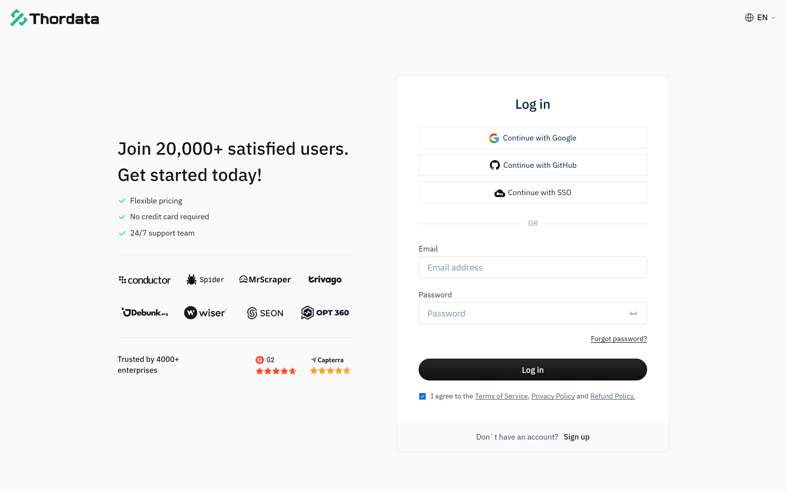
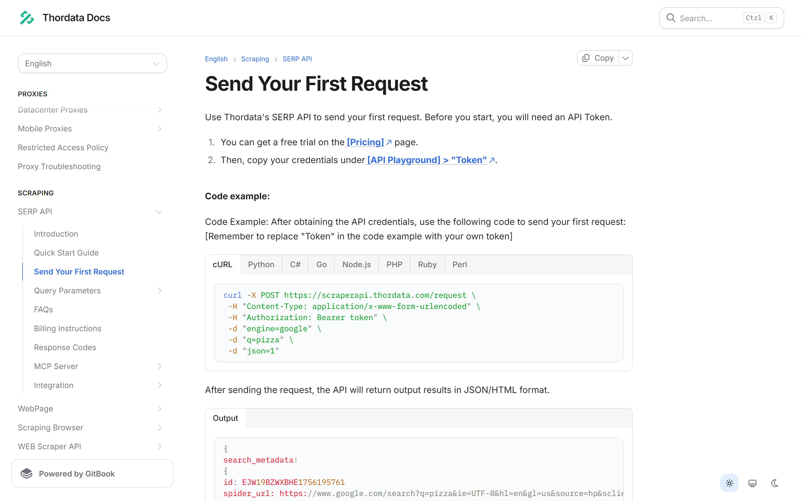
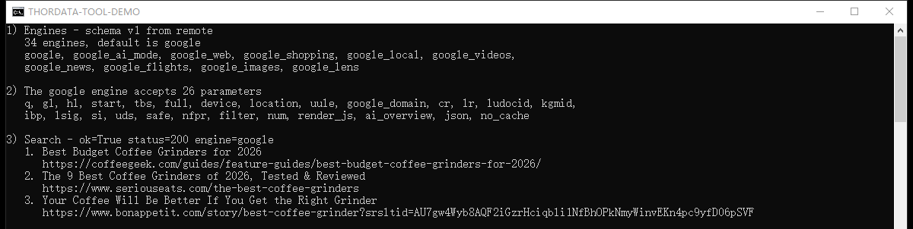
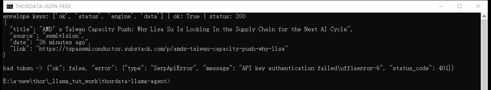

# Live Web Search for LlamaIndex Agents With Thordata

*A step-by-step guide to giving a LlamaIndex agent real-time search results: install the Thordata SERP tool spec, read the live engine schema it fetches, run a search, and let a `FunctionAgent` answer questions with data that did not exist when the model was trained.*

Hands-on tutorial · ~20 min read · Verified on 28–29 September 2026 with `llama-index-tools-thordata-serp` 0.2.0 from PyPI, `llama-index-core` 0.14.25 and the Thordata production SERP endpoint

An LLM on its own knows what it was trained on. Ask it about this week's search results and it will either refuse or, worse, invent an answer. The fix is not a bigger model — it is giving the model a tool that fetches the current page and hands back structured data it can cite.

This tutorial builds exactly that, end to end, using the Thordata SERP tool for LlamaIndex. It is deliberately narrow: one tool family, three tools, one agent. No vector stores, no ingestion pipelines — this is the search half of the picture, wired so an agent can use it.

In this guide you will learn how to:

- Install `llama-index-tools-thordata-serp` and load `ThordataSerpToolSpec`
- List the engines the tool can reach — 34 of them in the current schema — and read one engine's parameter schema
- Run a Google search from Python and read the normalized response envelope
- Connect any OpenAI-compatible LLM and wrap the tools in a `FunctionAgent`
- Stream the agent's tool calls in a REPL so you can see the search happen
- Extend the same agent to news, maps, shopping and scholar engines

**What's inside**

1. What LlamaIndex is, in one section
2. Why an agent needs live search — and why doing it yourself is expensive
3. The Thordata SERP tool: three tools, one envelope
4. Build the agent (project setup → token → tool → LLM → agent → REPL)
5. Extending it: more engines, more parameters, production notes

## What Is LlamaIndex?

LlamaIndex is an open-source Python framework for building applications on top of large language models. The project sits at around 52,000 stars on GitHub and is MIT licensed; the version this tutorial was written against is `llama-index-core` 0.14.25.

The pieces you need for this tutorial are three:

- **LLMs** — a provider wrapper (`OpenAI`, `OpenAILike`, `Anthropic`, …) that normalizes chat and function-calling across vendors.
- **Tools** — Python callables the model is allowed to invoke, described to the model by a name, a description and a JSON schema for the arguments.
- **Agents** — the loop that puts the two together: the model decides to call a tool, the framework runs it, the result goes back into the conversation, and the loop repeats until the model answers.

A *ToolSpec* is LlamaIndex's packaging convention for a group of related tools. That is the shape the Thordata integration ships in: one class, `ThordataSerpToolSpec`, that exposes three tools and can be dropped into any agent that accepts tools.

## Why Your LlamaIndex Agent Needs Live Search

Three properties of large language models make search tools necessary rather than optional:

- **Training data has a cut-off.** Anything dated after it — prices, releases, outages, regulations, this year's product comparisons — is simply unknown to the model.
- **Models rarely say "I don't know."** Asked about a recent event, a model without tools will often produce a fluent, plausible, wrong answer, complete with an invented citation.
- **Chitchat is not evidence.** Even when the model is roughly right, you usually need the source URL so a human can check it.

The usual workaround — paste search results into the prompt by hand — does not survive contact with an agent, because the agent decides for itself which query to run and when. The tool has to be callable.

### Doing it yourself is where the cost hides

Fetching a search engine results page looks like a ten-line script and behaves like a maintenance contract. You end up owning CAPTCHA and bot-detection handling, proxy rotation, per-country and per-language result targeting, HTML that changes without notice, and a parser for every engine you touch. The parsing is the part teams underestimate: the interesting fields rarely live in one list — news results, answer boxes, local packs and related questions all sit in different places per engine.

Thordata's SERP API exists to own that half. One HTTPS request returns parsed JSON for the engine you asked for, with proxy handling and geolocation included.

### The half the agent cares about

Even with a good endpoint, an agent needs something a raw API does not give you: a set of parameters that is *discoverable at runtime*. Agents pick arguments themselves, and an agent that guesses a parameter name gets a 400 — or worse, silently searches the wrong thing.

The LlamaIndex package solves this with the schema Thordata publishes for its own playground. Before a request is sent, the tool checks your parameters against the live schema for the selected engine and drops anything that engine does not declare. That is the difference between "call this API" and "call this API from an agent": the tool is safe to expose to a model that has never read the docs.

## The Thordata SERP Tool, in One Page

The package is `llama-index-tools-thordata-serp` 0.2.0; the import path is `llama_index.tools.thordata_serp`. It requires Python 3.10 or newer and pulls in `llama-index-core` (>=0.13.0, <0.15), `pydantic` and `requests`.

One class — `ThordataSerpToolSpec` — exposes exactly three tools:

| Tool | What it does | Why an agent needs it |
| --- | --- | --- |
| `list_engines()` | Returns the schema version, the default engine, the schema source and a compact record (key, name, query field) for every engine. | The agent can discover that `google_news` or `google_maps` exist instead of hard-coding a guess. |
| `get_engine_schema(engine)` | Returns one engine's complete parameter groups and fields, including types and allowed values. | The agent can check which parameter a query needs — `q` for most engines, `departure_id` for flights, `url` for Lens. |
| `search(engine, query, params, response_format, response_mode)` | Validates the parameters against the schema, sends the request and returns the parsed result inside a normalized envelope. | This is the actual search; everything the model can control goes through this one signature. |

Every tool returns a **JSON string**, not a Python object. Decode it with `json.loads` before reading fields. Successful calls and failures share one shape, so error handling never depends on exceptions:

```json
{"ok": true, "status": 200, "engine": "google", "data": { ... }}

{"ok": false, "error": {"type": "SerpApiError", "status_code": 401, "message": "..."}}
```

Two more behaviours are worth knowing before you write any glue code:

- **The schema is fetched once and cached.** The first call reports `schema_source: "remote"`; calls within the next five minutes report `"cache"`. If the remote schema cannot be reached before any schema is loaded, the package falls back to a snapshot bundled inside the wheel and reports `"snapshot"`. Only `list_engines` and `get_engine_schema` include that field — `search` returns `ok`, `status`, `engine` and `data`.
- **Requests and responses are bounded.** Request bodies are capped at 1 MB and responses at 10 MB, with a 120-second default timeout for searches and 30 seconds for the schema. The API Token is never echoed back: string values in responses are redacted if they contain it.

> **The tool never reads environment variables itself.** The API Token is always passed in explicitly (`ThordataSerpToolSpec(api_key=...)` — `api_key` is the package's own argument name, and the value it takes is the Thordata API Token). That is deliberate — it keeps configuration in your application instead of hiding it inside a dependency — and it is why every example below reads the API Token from the environment and hands it over.

## Build a LlamaIndex Agent That Searches the Web

### Prerequisites

- **Python 3.10 or newer** — the 0.2.0 metadata declares `>=3.10,<4.0`; this tutorial was verified on 3.12.
- **A Thordata SERP API token** — created in the dashboard, free trial credits included.
- **An OpenAI-compatible LLM endpoint** — a hosted provider API token, or a local server such as Ollama. The tool itself needs no LLM; only the agent does.

### 1. Create the project

Everything lives in one folder with its own virtual environment:

```bash
mkdir thordata-llama-agent
cd thordata-llama-agent
python -m venv .venv
```

Activate it — the command differs per shell:

```bash
# Windows (PowerShell)
.venv\Scripts\Activate.ps1

# Windows (cmd.exe)
.venv\Scripts\activate.bat

# macOS / Linux
source .venv/bin/activate
```

Then install the tool package along with `python-dotenv`, which the scripts below use to read the `.env` file. The tool package brings `llama-index-core`, `pydantic` and `requests` with it, so this is the only install you need for the first steps:

```bash
python -m pip install llama-index-tools-thordata-serp python-dotenv
```

### 2. Keep the tokens in `.env`

Two credentials are involved: the Thordata API Token and the LLM's API Token. Put both in a `.env` file next to the code and never in the source:

```env
# Thordata SERP token, from the dashboard
# (SERP API -> API Token, also reachable as API Playground -> Token)
THORDATA_SERP_API_TOKEN=your-thordata-serp-token

# Any OpenAI-compatible endpoint. The values below are a local Ollama server;
# for a hosted provider use e.g. https://api.openai.com/v1 with your own model.
LLM_BASE_URL=http://127.0.0.1:11434/v1
LLM_MODEL=qwen3:1.7b
LLM_API_TOKEN=ollama

# Optional. Only needed for models whose context window LlamaIndex cannot look up.
# LLM_CONTEXT_WINDOW=32768
```

Add `.env` to your `.gitignore` as the first thing you do. A committed API Token is a cancelled token.

### 3. Get your Thordata SERP token

Sign in to the [Thordata dashboard](https://dashboard.thordata.com/serp-api/get-started) and copy your SERP token — the documentation points at it from two places: the SERP API page (**SERP API → API Token**) and **API Playground → Token**. If you have not generated a token yet, generate one first; the free trial credits sit on the same page.



*The dashboard sign-in page. New accounts can sign up from the same screen; behind it, the docs point to the SERP token from *SERP API → API Token* and from *API Playground → Token*, and the page below shows the raw request that token authorises.*

The token authenticates a plain HTTPS call, which is useful to see once before any Python is involved. The documentation's own first-request example is a good reference point, because the package you just installed is a wrapper around exactly this call:



*The raw request the tool sends for you: POST to `scraperapi.thordata.com/request` with a Bearer token, `engine`, the query and `json=1`.*

Under the hood, the tool posts to `https://scraperapi.thordata.com/request` with form-encoded fields (`engine`, the engine's query field, and `json`), and fetches the engine schema from `https://api.thordata.com/serp/playground/schema?lang=en`. You do not need to configure either one, but both can be overridden in the constructor if you route traffic through your own proxy.

### 4. Load the tool and look at what it can reach

Save this as `tool_demo.py`. It calls the package with no agent and no LLM involved — the fastest way to confirm the token works and to see the schema for yourself:

```python
"""Call the Thordata SERP tool directly - no agent, no LLM involved."""

import json
import os
import textwrap

from dotenv import load_dotenv
from llama_index.tools.thordata_serp import ThordataSerpToolSpec

load_dotenv()

tool_spec = ThordataSerpToolSpec(api_key=os.environ["THORDATA_SERP_API_TOKEN"])

# 1. Which engines can this tool reach?
engines = json.loads(tool_spec.list_engines())
keys = [engine["key"] for engine in engines["engines"]]
print(f"1) Engines - schema v{engines['schema_version']} from {engines['schema_source']}")
print(f"   {len(keys)} engines, default is {engines['default_engine']}")
print(textwrap.fill(", ".join(keys[:10]), width=96, initial_indent="   ", subsequent_indent="   "))

# 2. What parameters does the google engine accept?
schema = json.loads(tool_spec.get_engine_schema("google"))
fields = [field["key"] for group in schema["engine"]["groups"] for field in group["fields"]]
print(f"\n2) The google engine accepts {len(fields)} parameters")
print(textwrap.fill(", ".join(fields), width=96, initial_indent="   ", subsequent_indent="   "))

# 3. Run a search and print the organic results.
result = json.loads(
    tool_spec.search(
        engine="google",
        query="best coffee grinders 2026",
        params={"num": 3, "gl": "us", "hl": "en"},
        response_mode="compact",
    )
)
if not result["ok"]:
    print(f"\n3) Search failed - {result['error']['type']}: {result['error']['message']}")
    raise SystemExit(1)
print(f"\n3) Search - ok={result['ok']} status={result['status']} engine={result['engine']}")
for item in result["data"]["organic"]:
    print(f"   {item['position']}. {item['title']}")
    print(f"      {item['link']}")
```

Run it with `python tool_demo.py`. Two things are worth pausing on in the output below. First, the schema came back from `remote`, not from the bundled snapshot. Second, the field list is the answer to "what can I pass?" — `num`, `gl`, `hl`, `tbs`, `safe`, `location` and twenty more for Google, all validated before anything is sent. The search block also checks `ok` before it reads any result field, so an invalid or expired token prints one readable line instead of a `KeyError` — the same guard the failure section below revisits.



*A real run: 34 engines, 26 parameters on the Google engine, and live organic results — all from one Python file and no LLM.*

The engine list is not decoration. Grouped by provider, the live schema currently offers 26 Google engines (Search, AI Mode, Web, Shopping, Local, Videos, News, Flights, Images, Lens, Trends, Hotels, Play, Jobs, Scholar, Maps, Finance, Patents and their variants), 6 Bing engines (Search, Images, Videos, News, Maps, Shopping), Yandex Search and DuckDuckGo Search. Because the schema is fetched at runtime, that list can grow without a package release.

### 5. Read the response envelope

Before handing the tool to a model, it is worth seeing exactly what the model will see. This snippet prints one news result and the envelope for a deliberately invalid token:

```python
import json
import os

from dotenv import load_dotenv
from llama_index.tools.thordata_serp import ThordataSerpToolSpec

load_dotenv()

tool_spec = ThordataSerpToolSpec(api_key=os.environ["THORDATA_SERP_API_TOKEN"])
raw = tool_spec.search(
    engine="google_news",
    query="semiconductor supply chain",
    response_mode="compact",
)
data = json.loads(raw)
if not data["ok"]:
    raise SystemExit(f"search failed: {data['error']}")
print("envelope keys:", list(data.keys()), "| ok:", data["ok"], "| status:", data["status"])

headline = data["data"]["news"][0]
fields = {key: headline[key] for key in ("title", "source", "date", "link")}
print(json.dumps(fields, indent=2, ensure_ascii=False))

invalid_spec = ThordataSerpToolSpec(api_key="00000000000000000000000000000000")
bad = json.loads(invalid_spec.search(engine="google", query="test"))
print("\nbad token ->", json.dumps(bad))
```



*Top: a real news result inside the envelope. Bottom: the same envelope shape for a rejected token — a 401 that arrives as data, not as an exception.*

The news result carries `title`, `link`, `source`, `date`, `snippet` and `image_url`; Google web results carry `position`, `title`, `link` and `description` under `data.organic`, alongside `people_also_ask` and `related` when the page has them. Other engines use their own key — `places` for Maps, `shopping` for Shopping, `organic_results` for Bing — which is why an agent should call `get_engine_schema` rather than assume one shape.

> **Use `response_mode="compact"` in agent code.** It removes `search_metadata`, `search_parameters`, `serpapi_pagination` and `request_metadata` from the payload at every nesting level. Those fields are useful when debugging a request and pure waste in a context window the model has to read.

> **Leave `response_format` at its default.** The tool sends it to the API as the `json` parameter and validates it locally: the accepted values are `"1"`, `"2"` and `"3"`, with `"1"` as the default. That accepted set does not line up with the engine schema's own list for the same field — `1` = JSON, `4` = Light JSON, `3` = HTML, `5` = Screenshot — so `"4"` and `"5"` cannot be requested at all (they come back as a validation error inside the envelope), while `"3"` is passed through even though the schema defines it as HTML. In our runs the endpoint returned the same parsed JSON for `1`, `2` and `3`, which is why the default is the safe choice for an agent.

### 6. Connect an LLM

The tool spec is complete without a model, but an agent is not. Install an OpenAI-compatible client — this one also works against any server that speaks the same API, which is what makes local models and self-hosted gateways usable here:

```bash
python -m pip install llama-index-llms-openai-like
```

The agent code below reads three values from `.env`: `LLM_BASE_URL`, `LLM_MODEL` and `LLM_API_TOKEN`. Point them at OpenAI, at a local Ollama server, at vLLM, or at any provider that exposes an OpenAI-compatible endpoint — the code does not change. (If you use OpenAI's own models, `OpenAI` from `llama-index-llms-openai` works too; that class validates model names against OpenAI's catalogue, which is the one thing `OpenAILike` does not do.)

### 7. Define the agent

`FunctionAgent` is LlamaIndex's function-calling agent: it hands the tool schemas to the model, executes the calls the model asks for, and loops until the model answers. The system prompt is doing real work here — it tells the model to search *before* answering and to cite what it used, which is what keeps the answer grounded. Wrap it in a `build_agent()` function so the REPL can build the agent once at startup:

```python
"""A LlamaIndex agent that answers questions with live Thordata SERP data."""

import asyncio
import os

from dotenv import load_dotenv
from llama_index.core.agent.workflow import FunctionAgent, ToolCallResult
from llama_index.llms.openai_like import OpenAILike
from llama_index.tools.thordata_serp import ThordataSerpToolSpec

load_dotenv()

SYSTEM_PROMPT = (
    "You are a research assistant with a live web search tool. "
    "Always call the search tool before you answer, keep the answer under 120 words, "
    "and cite the result URLs you used."
)


def build_agent() -> FunctionAgent:
    """Wire the Thordata SERP tools and an OpenAI-compatible LLM into one agent."""
    tool_spec = ThordataSerpToolSpec(api_key=os.environ["THORDATA_SERP_API_TOKEN"])
    llm = OpenAILike(
        model=os.environ["LLM_MODEL"],
        api_base=os.environ["LLM_BASE_URL"],
        api_key=os.environ["LLM_API_TOKEN"],
        is_chat_model=True,
        is_function_calling_model=True,
        context_window=int(os.environ.get("LLM_CONTEXT_WINDOW", "32768")),
        timeout=300,
    )
    return FunctionAgent(
        tools=tool_spec.to_tool_list(),
        llm=llm,
        system_prompt=SYSTEM_PROMPT,
    )
```

Three details in that block are easy to miss and each one costs an hour if you do:

- `to_tool_list()` is what converts the ToolSpec into the tool objects the agent accepts. Passing the ToolSpec itself will not work.
- `is_chat_model` and `is_function_calling_model` must be set to `True` for any non-OpenAI model name. The flags are read when a request is built, not when the agent is constructed, so a mistake here surfaces on the first `agent.run()` — and the two flags fail differently: without `is_function_calling_model` you get *"LLM must be a FunctionCallingLLM"*; with that flag set but `is_chat_model` left at its default, the call goes to the completions endpoint instead of chat completions and fails with *"AsyncCompletions.create() got an unexpected keyword argument 'tools'"*.
- `context_window` has to be declared for the same reason — the framework cannot look up an unknown model name, and the default placeholder is far too small for a page of search results.

### 8. Build the REPL

Finally, a loop that asks a question and — this is the useful part — prints every tool call as it happens, using the real tool name and the arguments the model chose. Without it a slow answer looks like a hang; with it you can see that the model actually searched, and a metadata call such as `list_engines()` can never be mistaken for a search:

```python
async def ask(agent: FunctionAgent, question: str) -> str:
    """Run one turn and report every tool call while the agent works."""
    handler = agent.run(question)
    async for event in handler.stream_events():
        if isinstance(event, ToolCallResult):
            print(f"  [tool] {event.tool_name}({event.tool_kwargs})")
    return str(await handler)


async def main() -> None:
    agent = build_agent()
    print("Thordata SERP agent ready - ask a question, or type 'exit'.")
    while True:
        question = input("\nYou: ").strip()
        if question.lower() in {"exit", "quit"}:
            break
        if question:
            print(f"\nAgent: {await ask(agent, question)}")


if __name__ == "__main__":
    asyncio.run(main())
```

Steps 7 and 8 together are the complete file — imports, agent and REPL — and it ships as `code/agent.py` next to this page. Copy it into the project you created in step 1 and run it:

```
python agent.py
```

### 9. Run it

Here is a real session. The question needs data from 2026, the model calls the search tool once with a query of its own choosing, and the answer cites two URLs that came back in that response:


*A real session against the production SERP endpoint: one tool call, then an answer whose citations are the result URLs from that call.*

Two checks make that screenshot trustworthy rather than merely convincing, and both are worth repeating with your own questions. The `[tool]` line names the tool the model actually called and prints the arguments it chose — `search` with a query, an engine and a response format in this run — so a metadata call such as `list_engines()` can never be mistaken for a search. And the cited links can be compared against the raw response for that query: in this run the top results were `coffeegeek.com` at position 1 and `coffeechronicler.com` at position 2, which is exactly what the answer cites.

> **Grounding is a property of your prompt and your model, not of the tool.** In a second run of the same question, the local model kept the right search and the right top result, then attributed the second citation to a domain that was not in the response at all — a plausible-looking URL it invented. The tool returned clean data; the model embellished it. So keep two habits: log the tool calls, and spot-check that the URLs in an answer actually appear in the tool result.

## Taking It Further

### Ask a different engine

Nothing about the agent is Google-specific. The engine is just an argument — the same tool covers news, maps and shopping, and the agent can pick the engine itself once `list_engines` is available to it:

```
news = tool_spec.search(engine="google_news", query="ai regulation", response_mode="compact")
places = tool_spec.search(engine="google_maps", query="coffee shops in seattle", params={"num": 3}, response_mode="compact")
prices = tool_spec.search(engine="google_shopping", query="espresso machine", params={"num": 3}, response_mode="compact")
papers = tool_spec.search(engine="google_scholar", query="retrieval augmented generation", params={"num": 3}, response_mode="compact")
```

Each returns its own result key — `news`, `places`, `shopping`, `organic` — so if you consume them in code rather than through an agent, keep a small mapping table instead of assuming one field name.

### Parameters that are worth setting explicitly

The schema is the contract, and three Google parameters earn their place in almost every call:

- `num` — how many results to return. Ten results of raw JSON is a lot of context; three is usually enough for a summary.
- `gl` — the country whose Google you are querying. Result sets differ per country, and a model has no way to infer which one you meant.
- `hl` — the interface language.

Anything you pass that the selected engine does not declare is dropped before the request is sent, so a typo degrades into a default search rather than an error. That is forgiving in production and confusing while debugging — if a parameter seems to have no effect, call `get_engine_schema` and check the spelling against the field list.

### Handle failures in one place

Because every tool returns the same envelope, error handling is a single branch — including upstream failures, which arrive as `ok: false` with a status code:

```python
result = json.loads(tool_spec.search(engine="google", query="coffee"))
if not result["ok"]:
    print(result["error"]["type"], result["error"].get("status_code"), result["error"]["message"])
```

In an agent, the same envelope is handed to the model, which means a failed search becomes something the model can react to — retry with a different query, or tell the user what it could not find — instead of an exception that ends the run.

### Production notes

- **Reuse one ToolSpec per process.** The schema cache lives on the instance, so building a new one per request throws away the five-minute cache and re-fetches the schema.
- **Expect the schema to change.** Engines and fields are published by the API, not frozen in the package. Read `schema_source` when you need to know whether a run used a live schema, a cached one or the bundled snapshot.
- **Budget the tokens, not just the credits.** Every search result you return is context the model must read. `response_mode="compact"` and a small `num` are cheaper than a larger context window.
- **Keep the API Token out of prompts and logs.** The package redacts it from responses, but a token printed by your own code is still leaked.

## Conclusion

Pairing LlamaIndex with Thordata's SERP API gives you an agent built on two things you control: the tool runs in your own process, and every answer is fetched live at the moment it is asked for. The integration is small enough to read in one sitting — three tools and one envelope — and every part of it is swappable: change the engine, the query parameters, the LLM or the system prompt without touching the rest.

The same shape reaches well past Google web results. The tool exposes the platform's whole engine catalogue, so one argument is all it takes to move from web pages to news, shopping prices, scholarly papers, local listings or search trends — and because `get_engine_schema` tells the model what each engine accepts, the agent can make that choice itself. When you also need your own documents in the answer, feeding these results into a LlamaIndex index is the framework's other half, and it does not change anything above.

To point it at your own account, create an API token in the [Thordata dashboard](https://www.thordata.com) and keep [doc.thordata.com](https://doc.thordata.com) open for the parameter reference — the SERP API section documents what each engine accepts. The two scripts and every screenshot used above are in this folder.
